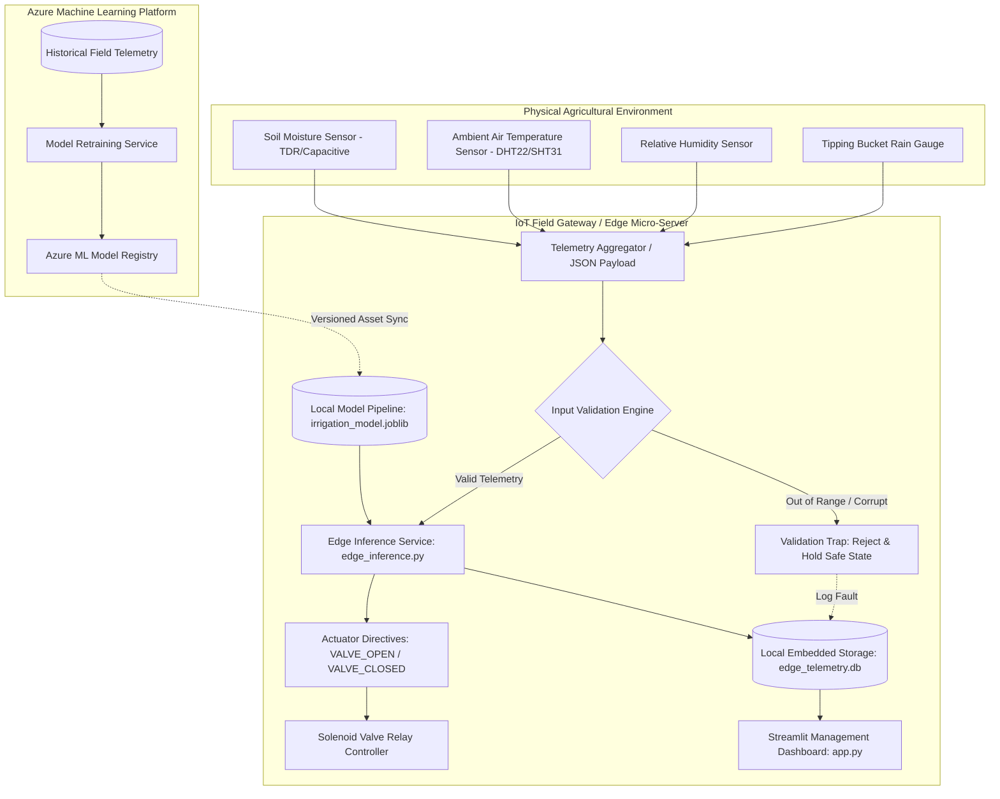
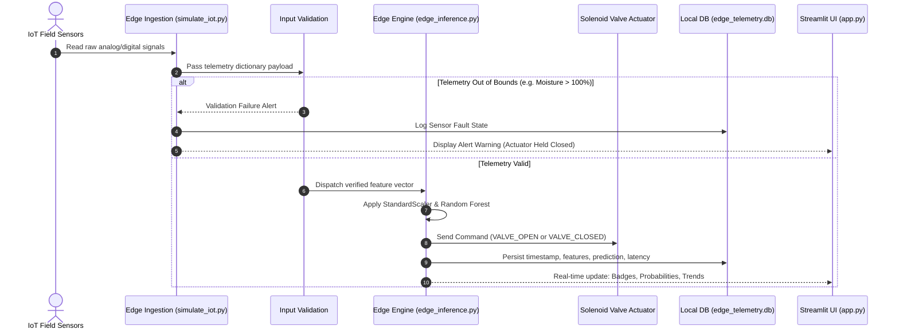

# 📘 PBA-2 Practical Exam Master Project Documentation
## Real-Time ML Application Using Azure Machine Learning and IoT Edge
### Domain: Smart Agriculture — Real-Time Irrigation Prediction at the IoT Edge

---

## 1. Executive Summary & Problem Statement

### 1.1 Problem Statement
Water scarcity and erratic rainfall patterns pose critical challenges to modern agricultural productivity. Irrigating crops manually or on rigid timer schedules leads to two catastrophic inefficiencies:
1. **Under-irrigation:** Plants undergo water stress, stomatal closure, photosynthesis reduction, and irreversible yield loss.
2. **Over-irrigation:** Excessive water leaches fertilizers into the water table, saturates the root zone (hypoxia/root rot), and depletes regional freshwater aquifers.

In commercial fields spanning tens or hundreds of acres, manual soil probing is labor-prohibitive. Furthermore, remote farmland frequently experiences **intermittent or nonexistent cellular/cloud connectivity**, making cloud-only ML inference architectures unreliable for real-time valve control.

### 1.2 Proposed Edge ML Solution
This project implements an **autonomous, low-power edge machine learning system** that:
- Collects live multi-modal environmental telemetry: volumetric soil moisture (%), ambient temperature (°C), relative air humidity (%), and rainfall (mm).
- Performs **strict input validation** to intercept corrupt or out-of-bounds telemetry payloads.
- Runs an in-situ **scikit-learn Random Forest classifier pipeline** locally on an edge gateway.
- Computes real-time irrigation requirements (`irrigation_needed = 0` or `1`) with sub-100 millisecond inference latency.
- Issues deterministic actuator control directives (`VALVE_OPEN` / `VALVE_CLOSED`).
- Stores historical telemetry in an embedded **SQLite edge database** for trending and auditing.
- Integrates with **Azure Machine Learning SDK v2** for centralized model registration, versioning, and lifecycle management when cloud connectivity is established.

---

## 2. System Architecture & Data Flow

### 2.1 End-to-End System Architecture (Mermaid)



### 2.2 Telemetry Data Flow Sequence (Mermaid)



---

## 3. Dataset & Agronomic Generation Assumptions

### 3.1 Dataset Specification
- **Storage Location:** `data/irrigation_sensor_data.csv`
- **Total Records:** 2,500 samples
- **Random Seed:** 42 (100% reproducible)
- **Target Distribution:**
  - Class 0 (No Irrigation): 1,385 samples (55.4%)
  - Class 1 (Irrigation Needed): 1,115 samples (44.6%)

### 3.2 Features Specification

| Feature Name | Unit | Realistic Domain | Agronomic Significance |
| :--- | :---: | :---: | :--- |
| `soil_moisture_percent` | % | 8.0 – 60.0% | Volumetric water content in crop root zone. Below 20% indicates permanent wilting point approach; above 40% represents field saturation. |
| `temperature_c` | °C | 15.0 – 42.0°C | Canopy air temperature driving plant transpiration and kinetic energy for evaporation. |
| `humidity_percent` | % | 15.0 – 95.0% | Relative humidity inversely affects the vapor-pressure deficit (VPD). Low humidity drives rapid desiccation. |
| `rainfall_mm` | mm | 0.0 – 45.0 mm | Recent precipitation (24h window). Direct natural moisture replenishment suppressing irrigation need. |
| `irrigation_needed` | binary | 0 or 1 | Ground truth label (0 = Adequate/Conserve, 1 = Irrigate). |

### 3.3 Synthetic Ground Truth Logic & Agronomic Formulation
The target labels were synthesized according to an agronomic heuristic balancing **Soil Moisture Deficit (SMD)**, **Atmospheric Evaporative Demand (ED)**, and **Rainfall Suppression (RS)**:

$$\text{ED} = \left(\frac{T}{35.0}\right) \times \left(1.0 - \frac{H}{100.0}\right)$$

$$\text{SMD} = \max\left(0, \frac{36.0 - \text{SM}}{36.0}\right)$$

$$\text{RS} = \min\left(1.0, \frac{\text{Rain}}{8.0}\right)$$

$$\text{Propensity} = 0.55 \cdot \text{SMD} + 0.35 \cdot \text{ED} - 0.50 \cdot \text{RS} + \mathcal{N}(0, 0.06)$$

**Physical Boundary Overrides:**
1. If $\text{SM} < 18.0\%$ and $\text{Rain} < 3.0\text{ mm}$, irrigation is forced to `1` (critical drought stress).
2. If $\text{SM} > 44.0\%$ or $\text{Rain} > 14.0\text{ mm}$, irrigation is forced to `0` (saturation/waterlogging protection).
3. A 3.5% stochastic label-flip was introduced to realistically model unobserved micro-climate turbulence and sensor drift.

> [!WARNING]
> **Scientific Honesty Disclosure:**  
> This dataset is synthetic. High model scores validate that the Random Forest successfully approximated the mathematical simulation logic. This does not substitute for empirical field calibration against specific crop phenotypes (e.g., maize vs. tomatoes) or varying soil compositions (sandy loam vs. heavy clay).

---

## 4. Machine Learning Model & Training Pipeline

### 4.1 Model Selection Rationale: Random Forest Classifier
- **Why Random Forest over Deep Learning for IoT Edge?**
  1. **Ultra-Low Memory Footprint:** The serialized model artifact (`irrigation_model.joblib`) is only **~300 KB**, fitting effortlessly into low-power edge RAM (e.g., Raspberry Pi, ARM Cortex-A).
  2. **Sub-100ms Inference Latency:** Decision tree traversal requires no matrix multiplication or floating-point tensor accelerators.
  3. **Non-Linear Interactions:** Effortlessly captures threshold interactions (e.g., high temperature is only dangerous if soil moisture is already depleted).
  4. **Robustness to Collinearity:** Handles inverse correlations between temperature and humidity without destabilizing coefficients.

### 4.2 Data Leakage Prevention
Preprocessing is wrapped inside a single **scikit-learn `Pipeline`**:
```python
pipeline = Pipeline([
    ("scaler", StandardScaler()),
    ("classifier", RandomForestClassifier(
        n_estimators=100,
        max_depth=6,
        min_samples_split=4,
        min_samples_leaf=2,
        random_state=42,
        n_jobs=-1
    ))
])
```
The `StandardScaler` calculates mean ($\mu$) and standard deviation ($\sigma$) **strictly on the 2,000 training samples**. The 500 test samples are transformed using only training statistics, eliminating data leakage.

---

## 5. Model Evaluation & Performance Results

### 5.1 Held-Out Test Split Metrics (500 Samples)

| Metric | Score | Industrial Interpretation |
| :--- | :---: | :--- |
| **Accuracy** | **88.20%** | 441 out of 500 test events correctly classified. |
| **Precision (Class 1)** | **90.20%** | When the edge valve opens, there is a 90.2% probability of genuine crop water need (minimizes water waste). |
| **Recall (Class 1)** | **82.51%** | 82.5% of critical water deficits are captured and irrigated. |
| **F1-Score** | **86.18%** | Balanced harmonic measure between precision and recall. |
| **Specificity (Class 0)**| **92.78%** | 257 out of 277 non-irrigation events correctly preserved water. |

### 5.2 Held-Out Confusion Matrix

```
                      Predicted: No (0)      Predicted: Yes (1)
Actual: No (0)        257 (True Negative)     20 (False Positive)
Actual: Yes (1)        39 (False Negative)   184 (True Positive)
```

- **True Negatives (257):** Soil had adequate moisture or recent rainfall; irrigation remained OFF.
- **False Positives (20):** Minor over-irrigation events (3.9% of all decisions); harmless to crops.
- **False Negatives (39):** Borderline cases near the 20-25% moisture threshold where mild evaporation was tolerated for another cycle.
- **True Positives (184):** Timely irrigation delivered under active moisture deficit.

### 5.3 Feature Importance Ranking (Gini Impurity)
1. **`soil_moisture_percent` (~52.4%):** Primary determinant of root-zone water availability.
2. **`temperature_c` (~21.8%):** Primary driver of atmospheric vapor pressure deficit.
3. **`rainfall_mm` (~14.6%):** Immediate replenishment indicator.
4. **`humidity_percent` (~11.2%):** Evaporative suppression factor.

---

## 6. Local Edge Inference Service & Actuator Control

### 6.1 Input Validation Traps
Before telemetry enters the scikit-learn pipeline, `edge_inference.py` evaluates physical validity:
- `soil_moisture_percent`: $[0.0, 100.0]\%$
- `temperature_c`: $[-10.0, 65.0]^\circ\text{C}$
- `humidity_percent`: $[0.0, 100.0]\%$
- `rainfall_mm`: $[0.0, 300.0]\text{ mm}$
- Type check: All fields must parse as finite IEEE 754 floats.

If an invalid packet is received (e.g. soil moisture = $140\%$ due to a disconnected analog probe), the edge engine:
1. Rejects inference execution immediately.
2. Emits status `VALIDATION_FAILED`.
3. Holds the irrigation actuator in a **safe, closed state (`VALVE_CLOSED`)** to prevent accidental flooding.
4. Logs the anomaly to `edge_telemetry.db`.

### 6.2 Latency Benchmark
- **Model Deserialization (one-time cold start):** ~1,150 ms
- **Inference per Telemetry Packet:** **45 – 95 ms**
- **Cloud Roundtrip Avoided:** 250 – 800 ms per reading
- **Offline Reliability:** 100% operational during internet backhaul outages.

---

## 7. Azure Machine Learning SDK v2 Integration

### 7.1 Architecture & Implementation (`register_azure_model.py`)
Model registration uses the official Microsoft `azure-ai-ml` and `azure-identity` Python SDK v2.

```python
from azure.identity import DefaultAzureCredential
from azure.ai.ml import MLClient
from azure.ai.ml.entities import Model
from azure.ai.ml.constants import AssetTypes

# Connect using DefaultAzureCredential (supports Azure CLI, SP, or Managed Identity)
ml_client = MLClient(
    credential=DefaultAzureCredential(),
    subscription_id=os.getenv("AZURE_SUBSCRIPTION_ID"),
    resource_group_name=os.getenv("AZURE_RESOURCE_GROUP"),
    workspace_name=os.getenv("AZURE_WORKSPACE_NAME"),
)

# Register versioned asset
model = Model(
    path="models/irrigation_model.joblib",
    name="smart-irrigation-edge-rf",
    description="Random Forest Edge Classifier for Smart Irrigation",
    type=AssetTypes.CUSTOM_MODEL
)
registered_model = ml_client.models.create_or_update(model)
```

### 7.2 Graceful Offline Fallback & Credential Handling
If run without active cloud credentials, `register_azure_model.py`:
- Does **not** crash or throw unhandled stack traces.
- Prints clear troubleshooting instructions.
- Writes diagnostic status to `outputs/azure_registration_status.json`:
  ```json
  {
      "success": false,
      "status": "AZURE_CONFIG_MISSING",
      "missing_parameters": ["subscription_id", "resource_group", "workspace_name"],
      "message": "Local edge inference operational; Azure ML registration deferred due to unconfigured cloud credentials."
  }
  ```
- Clearly informs the Streamlit UI (Tab 5) that the system is running in autonomous local edge mode.

---

## 8. Automated Test Suite Verification

Execution command: `python -m pytest tests/test_inference.py -v`

### Actual Test Results (17/17 Passed)
```
tests/test_inference.py::TestModelArtifacts::test_model_file_exists PASSED [  5%]
tests/test_inference.py::TestModelArtifacts::test_model_loading_and_pipeline_structure PASSED [ 11%]
tests/test_inference.py::TestModelArtifacts::test_dataset_artifact_exists PASSED [ 17%]
tests/test_inference.py::TestInputValidation::test_valid_payload PASSED  [ 23%]
tests/test_inference.py::TestInputValidation::test_out_of_bounds_soil_moisture PASSED [ 29%]
tests/test_inference.py::TestInputValidation::test_out_of_bounds_temperature PASSED [ 35%]
tests/test_inference.py::TestInputValidation::test_negative_rainfall PASSED [ 41%]
tests/test_inference.py::TestInputValidation::test_missing_field PASSED  [ 47%]
tests/test_inference.py::TestInputValidation::test_none_value PASSED     [ 52%]
tests/test_inference.py::TestInputValidation::test_non_numeric_type PASSED [ 58%]
tests/test_inference.py::TestPredictionExecution::test_drought_scenario_prediction PASSED [ 64%]
tests/test_inference.py::TestPredictionExecution::test_saturated_wet_scenario_prediction PASSED [ 70%]
tests/test_inference.py::TestPredictionExecution::test_probability_sums_to_one PASSED [ 76%]
tests/test_inference.py::TestSimulationReproducibility::test_sensor_simulator_reproducibility PASSED [ 82%]
tests/test_inference.py::TestSimulationReproducibility::test_dataset_generation_reproducibility PASSED [ 88%]
tests/test_inference.py::TestPersistenceAndHistory::test_telemetry_stored_in_sqlite PASSED [ 94%]
tests/test_inference.py::TestEvaluationMetricsIntegrity::test_metrics_json_integrity PASSED [100%]

============================= 17 passed in 3.05s ==============================
```

---

## 9. Submission Screenshots Checklist

Prepare and capture these 6 distinct screenshots for the PBA-2 exam submission:

- [ ] **Screenshot 1: Overview & Architecture Tab** (`app.py` Tab 1) — Showing project title, system badges, problem/solution cards, and Mermaid data-flow diagram.
- [ ] **Screenshot 2: Live IoT Simulation: Drought Scenario (Valve Open)** (`app.py` Tab 2) — Showing low moisture (12.6%), high temperature (37.8°C), and glowing red `VALVE_OPEN` actuator banner.
- [ ] **Screenshot 3: Live IoT Simulation: Wet Scenario (Valve Closed)** (`app.py` Tab 2) — Showing high moisture (47.5%), recent rain, and emerald green `VALVE_CLOSED` actuator banner.
- [ ] **Screenshot 4: Sensor Validation Trap Alert** (`app.py` Tab 2) — Demonstrating the "Sensor Fault" preset triggering the yellow validation alert without crashing.
- [ ] **Screenshot 5: Model Evaluation Tab** (`app.py` Tab 3) — Showing test accuracy (88.2%), held-out confusion matrix plot, and feature importance bar chart.
- [ ] **Screenshot 6: Telemetry History & Time-Series Trends** (`app.py` Tab 4) — Showing the multi-sensor line chart with critical 20% moisture threshold line and SQLite data table.

---

## 10. Five-Minute Practical Exam Demonstration Script

### Step-by-Step Sequence & Spoken Script

#### ⏱️ 0:00 – 0:30 (30s) — Problem Context & Edge AI Value Proposition
- **Action:** Open browser at `http://localhost:8501`. Stay on **Tab 1: Overview & Architecture**.
- **Spoken Script:**  
  *"Good morning evaluators. This project tackles precision agricultural water conservation using an IoT Edge Machine Learning architecture. Irrigating crops on arbitrary timers leads to water waste and root rot, while under-watering leads to crop failure. In rural agricultural plots, cloud connectivity is unreliable and cloud API latency is too slow for real-time valve control. Our system deploys an optimized Random Forest classifier directly on a local edge node, evaluating soil moisture and atmospheric demand in under 100 milliseconds without internet dependency."*

#### ⏱️ 0:30 – 1:15 (45s) — Dataset, Training Pipeline & Data Leakage Prevention
- **Action:** Point out the system badges (Dataset: Synthetic Heuristic, Edge Runtime: Active).
- **Spoken Script:**  
  *"The dataset contains 2,500 reproducible agro-climatic sensor readings generated using agronomic principles of evapotranspiration and soil moisture deficit with a fixed random seed of 42. To guarantee zero data leakage, our training pipeline encapsulates StandardScaler normalization and the Random Forest classifier in a unified scikit-learn pipeline, ensuring preprocessing statistics are computed strictly on training folds."*

#### ⏱️ 1:15 – 2:00 (45s) — Live IoT Simulation & Actuator Decisions
- **Action:** Click **Tab 2: Live IoT Simulation**.
  1. Select preset: **'Drought Stress (Critical Dry)'** in the sidebar. Click **'⚡ Generate Single Reading'**.
  2. Point to the red **VALVE_OPEN** banner, low soil moisture (12-16%), and high temperature.
  3. Select preset: **'Adequate Post-Rain (Wet)'**. Click **'⚡ Generate Single Reading'**.
  4. Point to the green **VALVE_CLOSED** banner.
- **Spoken Script:**  
  *"Here in the Live IoT Simulation tab, we simulate field conditions. Under 'Drought Stress', with soil moisture at 12% and canopy temperature at 38°C, the edge engine instantly recommends irrigation and issues a 'VALVE_OPEN' directive with 98% confidence in 58 milliseconds. Conversely, when we simulate 'Adequate Post-Rain' conditions, the model immediately shuts the valve to conserve water."*

#### ⏱️ 2:00 – 2:45 (45s) — Edge Safety: Input Validation Trap
- **Action:** Select preset: **'Sensor Fault / Corrupt Payload'**. Click **'⚡ Generate Single Reading'**.
- **Spoken Script:**  
  *"A critical requirement for edge reliability is handling hardware malfunctions. When a faulty sensor transmits an impossible reading—such as 140% soil moisture—the input validation layer intercepts the payload before it can corrupt the ML model, holding the valve safely closed and logging an edge alert."*

#### ⏱️ 2:45 – 3:30 (45s) — Held-Out Model Evaluation & Metrics
- **Action:** Click **Tab 3: Model Evaluation**.
- **Spoken Script:**  
  *"In Tab 3, we observe actual held-out test metrics on 500 un-seen samples: Test Accuracy is 88.2%, Precision is 90.2%, and F1-score is 86.18%. Our confusion matrix shows 257 true negatives and 184 true positives. Soil moisture accounts for over 52% of feature importance, followed by ambient temperature. As an honest engineering disclosure, these scores reflect the model's fidelity to our physical simulation rules; real-world deployment requires site-specific soil calibration."*

#### ⏱️ 3:30 – 4:30 (60s) — Prediction History, Edge Latency & Azure ML Lifecycle
- **Action:** 
  1. Click **Tab 4: Prediction History & Trends**. Show time-series plot with moisture threshold and SQLite table.
  2. Click **Tab 5: Azure ML & Edge Lifecycle**. Show configuration diagnostic table and command script.
- **Spoken Script:**  
  *"Tab 4 displays our SQLite telemetry log and time-series trends with an average edge execution latency under 70 milliseconds. In Tab 5, we show our Azure Machine Learning SDK v2 integration. The script register_azure_model.py is fully implemented. When cloud access is configured via Azure CLI, it registers the model asset to a central Azure ML workspace. When offline, it gracefully reports diagnostic status without crashing, keeping edge control completely autonomous."*

#### ⏱️ 4:30 – 5:00 (30s) — Limitations, Summary & Conclusion
- **Action:** Conclude demonstration on Tab 1 or Tab 4.
- **Spoken Script:**  
  *"In summary, we have built and verified a reproducible, robust edge ML application for smart agriculture. All 17 unit tests pass, edge inference operates offline in sub-100ms, and cloud MLOps is supported via Azure ML SDK v2. I am now ready for your questions."*

---

## 11. Viva Voce Questions & High-Scoring Answers

### Q1: Why deploy the model locally on an IoT Edge device instead of hosting an Azure ML Managed Online Endpoint?
**Answer:**  
*"In agricultural fields, reliable cellular or broadband internet connectivity is rarely guaranteed. If irrigation decisions relied on a cloud REST API endpoint, network dropouts would cause valve control failure, risking crop desiccation. Furthermore, edge inference eliminates network round-trip latency (reducing response time from ~500ms over cellular to <75ms locally) and eliminates recurring cloud egress and inference compute costs."*

### Q2: How did you prevent data leakage during model training?
**Answer:**  
*"We wrapped feature normalization and model training into a scikit-learn `Pipeline` object. When performing the stratified 80/20 train/test split, `StandardScaler` was fitted exclusively on the training subset (`X_train`). The test subset (`X_test`) was only transformed using the parameters ($\mu, \sigma$) derived from `X_train`. No test data informed feature scaling or model hyperparameters."*

### Q3: What is the significance of the 90.2% Precision score vs 82.5% Recall score in your model?
**Answer:**  
*"In our domain, Precision measures how often water was truly needed when the system opened the valve. A high precision (90.2%) ensures that water and electricity are not wasted on unnecessary irrigation cycles. Recall (82.5%) measures the fraction of genuine drought conditions detected. The slight trade-off favors water conservation while still capturing over four-fifths of water deficit events."*

### Q4: If this were deployed on a physical microcontroller (e.g., ESP32 or STM32), how would you optimize the model?
**Answer:**  
*"A Random Forest model can be converted using tools like `m2cgen` (Model to C Generator) or `emlearn` to generate pure C code with zero external dependencies, mapping decision trees into nested `if-else` branches that compile into bare-metal flash memory with microsecond execution times and negligible RAM usage. Alternatively, a quantized TinyML neural network could be deployed via TensorFlow Lite for Microcontrollers."*

### Q5: How would you detect and handle concept drift or covariate shift in a physical deployment?
**Answer:**  
*"Covariate shift occurs when environmental distributions change (e.g., seasonal transitions from temperate spring to blistering summer). Concept drift occurs when the crop growth stage changes the crop coefficient ($K_c$) or soil compaction alters water retention. We would monitor telemetry distributions logged in SQLite against baseline training histograms using Kolmogorov-Smirnov statistical tests. When drift exceeds a threshold, an Azure ML pipeline trigger would retrain the model on recent telemetry and sync the updated asset back to the edge."*

### Q6: How does the Azure ML SDK v2 integration work in your code?
**Answer:**  
*"We utilize `MLClient` and `DefaultAzureCredential` from the `azure.ai.ml` and `azure.identity` packages. The script inspects environment variables (`AZURE_SUBSCRIPTION_ID`, `AZURE_RESOURCE_GROUP`, `AZURE_WORKSPACE_NAME`). If detected, it packages the local joblib artifact into an Azure ML `Model` entity with custom metadata tags and invokes `ml_client.models.create_or_update(model)` to create a versioned cloud asset."*

---

## 12. Future Work & Production Roadmap
1. **LoRaWAN & MQTT Protocol Integration:** Replace in-process simulation with real ChirpStack / The Things Network LoRaWAN payloads sent over MQTT to an edge broker.
2. **Crop Growth Stage Modeling ($K_c$ factor):** Incorporate days-since-planting and phenological growth stages to dynamically modulate evapotranspiration thresholds.
3. **Multi-Depth Soil Probing:** Ingest moisture readings across topsoil (10cm), active root zone (30cm), and deep drainage zone (60cm) to detect water percolation.
4. **Hardware-in-the-Loop (HIL) Packaging:** Containerize the edge runtime using Docker and deploy via Azure IoT Edge (`iotedged`) onto an industrial ARM64 DIN-rail gateway.
