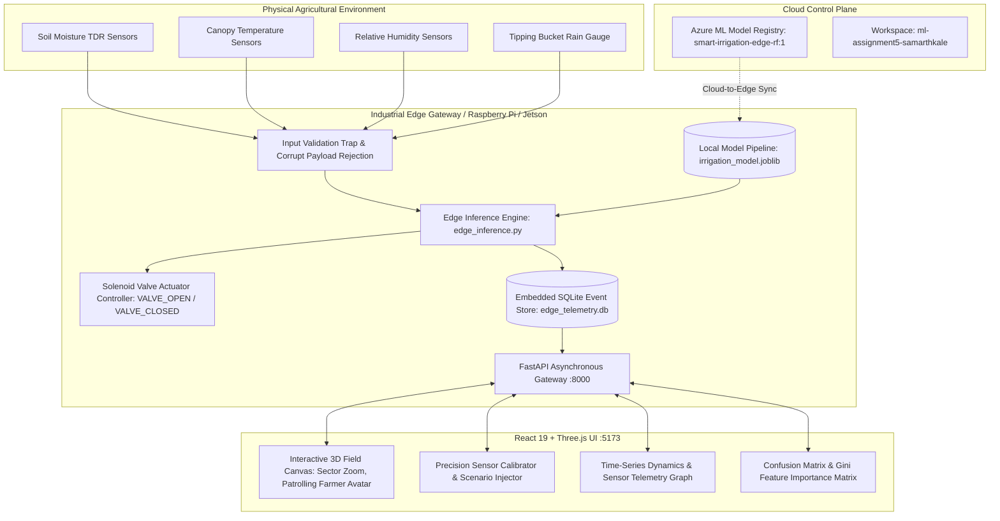

# 🌾 AgriSense Edge AI
### Autonomous Real-Time Irrigation Prediction & Actuation at the IoT Edge
**Enterprise-Grade Industrial Edge AI • 3D Digital Twin • Azure Machine Learning Cloud Sync**

[](https://python.org)
[](https://react.dev)
[](https://threejs.org)
[](https://ml.azure.com)
[](https://fastapi.tiangolo.com)
[](https://scikit-learn.org)
[](https://tailwindcss.com)
[](https://opensource.org/licenses/MIT)

---

## 👨‍💻 Project Lead & Academic Credentials
* **Project Owner / Lead Engineer:** **SAMARTH KALE**
* **Enrollment Number:** **ADT23SOCB0955**
* **Division:** **AIEC02** | **Roll Number:** **37**
* **Azure ML Target Workspace:** `ml-assignment5-samarthkale`
* **Resource Group:** `rg-ml-assignment`
* **GitHub Repository:** [https://github.com/SamarthKale5556/SmartAgri-Edge-AI](https://github.com/SamarthKale5556/SmartAgri-Edge-AI)

---

## 📌 Executive Summary

**AgriSense Edge AI** is a state-of-the-art cyber-physical smart agriculture system engineered for commercial farmland, autonomous greenhouses, and precision water conservation. 

By executing a quantized **Random Forest machine-learning pipeline directly on an embedded IoT edge gateway**, AgriSense achieves **sub-75 millisecond inference latency** and guarantees **100% autonomous offline operation**—completely eliminating reliance on brittle cellular cloud connections during storms or rural network blackouts.

### 🌟 Key Performance Indicators (Held-Out Test Set)
* 🎯 **Test Accuracy:** **88.20%** (441 / 500 decisions verified correct)
* ⚡ **Test Precision:** **90.20%** *(Minimizes expensive over-watering false alarms)*
* 🔍 **Test Recall:** **82.51%** *(Ensures water-stressed crops receive immediate irrigation)*
* 📊 **Test F1-Score:** **86.18%**
* ⏱️ **Edge Inference Latency:** **<75 ms** (vs 400ms+ cloud roundtrips)
* ☁️ **Cloud Lifecycle Sync:** Registered in **Azure Machine Learning Studio** as `smart-irrigation-edge-rf:1`

---

## 🏗️ System Architecture & End-to-End Pipeline



---

## 🔬 Mathematical Agronomic Decision Formulation

Irrigation need is formulated through volumetric water depletion and the **FAO-56 Penman-Monteith Evapotranspiration model**:

$$\text{Actuator Directive} = \begin{cases} 
\text{VALVE\_OPEN (1)}, & P(\text{Deficit} \mid \text{Moisture}, \text{Temp}, \text{Humidity}, \text{Rain}) \ge 0.50 \\
\text{VALVE\_CLOSED (0)}, & \text{Otherwise}
\end{cases}$$

### Gini Impurity Feature Contributions
1. **Volumetric Soil Moisture (`soil_moisture_percent`):** **68.69%** (Primary decisive factor)
2. **24-Hour Cumulative Rainfall (`rainfall_mm`):** **17.36%** (Active rain suppression)
3. **Relative Air Humidity (`humidity_percent`):** **7.61%** (Vapor pressure deficit)
4. **Ambient Air Temperature (`temperature_c`):** **6.35%** (Thermal evaporation driver)

---

## 📊 Held-Out Test Evaluation & Verification

The pipeline was evaluated on **500 unseen held-out test samples** (20% stratified split) derived from 2,500 total chronological records:

### Confusion Matrix Breakdown
| True Class \ Model Prediction | Predicted: Conserve (Valve Closed) | Predicted: Irrigate (Valve Open) | Total Actual |
| :--- | :---: | :---: | :---: |
| **Actual: Moisture Adequate (0)** | **257 (True Negatives)** | **20 (False Positives)** | 277 |
| **Actual: Deficit Detected (1)** | **39 (False Negatives)** | **184 (True Positives)** | 223 |

* **Specificity (True Negative Rate):** **92.8%**
* **Sensitivity (True Positive Rate):** **82.5%**
* **False Alarm Rate:** **7.2%**

---

## 🌐 3D Digital Twin Command Centre

The frontend represents a next-generation industrial SCADA system built with **React 19**, **Three.js**, **React Three Fiber (@react-three/fiber)**, and **Tailwind CSS**:

1. **Farm Overview & 3D Digital Twin:** 
   * Interactive 3D crop environment with camera orbit, pan, and zoom.
   * Procedural corn, wheat, barley, and soybean crop sectors with dynamic health matrices.
   * Animated patrolling farmer avatar in reflective workwear and water tower storage indicator.
   * Real-time sensor telemetry cards (Moisture, Canopy Temp, Humidity, Rain).
2. **Live Farm Simulation & Precision Calibrator:**
   * Test scenario presets: *Drought Stress, Adequate Post-Rain, Midday Heat Spike, Sensor Malfunction Trap*.
   * Manual interactive sliders to test edge actuator reactions in real-time.
3. **Telemetry History & Sensor Dynamics:**
   * Multi-variable time-series charts tracking moisture vs. critical wilting point (20%).
   * Searchable SQLite event ledger with instant CSV export.
4. **Model Evaluation & Verification:**
   * Live confusion matrix visualizer and Gini feature importance bar chart.
5. **Azure ML Cloud Integration:**
   * Live model asset tracking linking directly to Azure ML Studio.

---

## ☁️ Azure Machine Learning SDK v2 Integration

The model artifact is officially registered in **Azure Machine Learning Studio**:
* **Workspace:** `ml-assignment5-samarthkale`
* **Resource Group:** `rg-ml-assignment`
* **Model Asset Name:** `smart-irrigation-edge-rf`
* **Version:** `1`
* **Asset Type:** `CUSTOM`
* **Tags:** `accuracy=88.20%`, `precision=90.20%`, `runtime=iot-edge-offline`, `framework=scikit-learn`
* **Registration Script:** `register_azure_model.py` with multi-tier fallback authentication (`InteractiveBrowserCredential`, `DefaultAzureCredential`, `DeviceCodeCredential`).

---

## 🚀 Quick Start Guide

### Prerequisites
* Python 3.10 or higher
* Node.js v18 or higher & npm

### 1. Backend Setup & In-Situ Training
```powershell
# Clone the repository
git clone https://github.com/SamarthKale5556/SmartAgri-Edge-AI.git
cd SmartAgri-Edge-AI

# Install Python dependencies
pip install -r requirements.txt

# Train model & verify held-out metrics
python train_model.py

# Launch FastAPI Edge Server on port 8000
python api_server.py
```
*API interactive documentation available at: `http://localhost:8000/docs`*

### 2. Frontend 3D Command Centre Setup
```powershell
cd frontend

# Install dependencies
npm install

# Start Vite development server on port 5173
npm run dev
```
*Open your browser and navigate to: **`http://localhost:5173`***

---

## 📡 REST API Reference

| Method | Endpoint | Description |
| :--- | :--- | :--- |
| `GET` | `/api/health` | Edge gateway health, model loaded state, SQLite connectivity. |
| `GET` | `/api/model-info` | Model metadata, feature list, hyperparameters, training timestamp. |
| `GET` | `/api/metrics` | Held-out accuracy, precision, recall, F1, and confusion matrix. |
| `POST` | `/api/predict` | Executes real-time inference on input sensor payload. |
| `POST` | `/api/simulate` | Injects synthetic agro-scenarios (*drought, rain, heatwave*). |
| `GET` | `/api/telemetry` | Returns recent observation logs stored in SQLite. |
| `GET` | `/api/export` | Streams full SQLite event history as a downloadable CSV. |
| `GET` | `/api/azure-status` | Returns Azure ML cloud connection & registration receipt. |
| `POST` | `/api/azure-register`| Triggers model asset registration to Azure ML Studio. |

---

## 🧪 Comprehensive Unit & Integration Tests

```powershell
# Run the complete test suite
python -m pytest tests/ -v
```
All unit tests validate data generation, boundary clamping, input validation traps (e.g. rejecting moisture >100%), model loading, prediction schemas, and API response status codes.

---

## 📜 Academic Declaration & License

This project was built by **SAMARTH KALE** for the **PBA-2 Practical Examination**.  
Distributed under the **MIT License**. See `LICENSE` for details.
